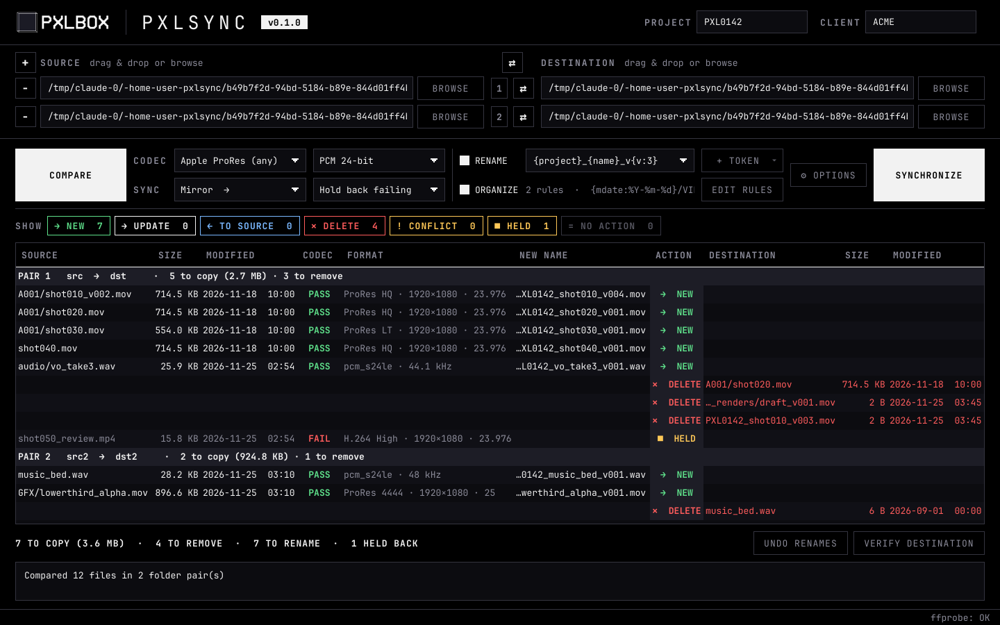

# pxlsync

PXLBOX's media sync tool: one screen, laid out like FreeFileSync.



1. **Folder pairs** at the top: sources on the left, destinations on the right. **+** adds a pair,
   **−** removes one, **⇄** swaps (the header one swaps all). Type, **BROWSE**, or drag a folder in.
   One source can go to several destinations (e.g. the NAS and a backup drive).
2. **Toolbar**
   - **CODEC**: the video and audio codec every file must use (ProRes 422 HQ, DNxHR HQ, H.264 High,
     PCM 24-bit, ...), and what happens to files that fail: block the sync, hold them back, or sync anyway.
   - **SYNC**: Mirror → (destination becomes an exact copy), Update → (copy new/changed, never delete),
     Two way ⇄ (newer wins).
   - **RENAME**: tick it and pick a template such as `{project}_{name}_v{v:3}`. Version numbers
     continue from what already exists in the sources and destinations.
   - **ORGANIZE**: tick it to sort files into folders, e.g. `{mdate:%Y-%m-%d}/VIDEO/{codec:upper}`.
     **EDIT RULES** to change them.
   - **⚙ OPTIONS**: compare method, where removed files go, ignore list, rename details.
3. **COMPARE** checks every codec (results are cached, so re-comparing is quick), works out the new
   names and folders, and compares every pair. The grid shows each file's codec (PASS/FAIL and
   format), its NEW NAME, and the ACTION: NEW / UPDATE / DELETE / CONFLICT / HELD. Filter with the
   chips; right-click rows to change their action.
4. **SYNCHRONIZE** renames/moves the files in the source (one undoable step: **UNDO RENAMES**), then
   copies, then compares again so you see the result. **VERIFY DESTINATION** re-reads the copies and
   checks their codecs match the source.

## Requirements on each workstation

Only **ffprobe** (part of ffmpeg) for the codec check, unless it's bundled into the build
(see `vendor/README.md`). Compare and sync are built in; no other software needed.
   - macOS: `brew install ffmpeg`
   - Windows: `winget install Gyan.FFmpeg`

## Run from source

```bash
python3 -m venv .venv && source .venv/bin/activate   # Windows: .venv\Scripts\activate
pip install -r requirements-dev.txt
python run_pxlsync.py
python -m pytest            # 15 tests, uses real ffmpeg-encoded clips
```

## macOS installer (.dmg)

**Easiest:** double-click **Build Installer.command** in Finder. It checks for Python
(and opens the python.org download page if it's missing), builds, then shows the finished DMG.

**Or from Terminal** on any Mac (macOS 12+, Python 3.10+), in the repo folder:

```bash
scripts/make_dmg.sh
```

This runs the tests, builds `pxlsync.app` and packs it into `dist/pxlsync-<version>.dmg`, with
the usual "drag to Applications" window. The app runs on Macs with the same chip as the one
that built it (Apple Silicon → Apple Silicon).

**On GitHub**: `.github/workflows/build-mac.yml` builds the same DMG on GitHub's Macs for every
push to `main` (download it under the run's *Artifacts*) and attaches it to a Release when you push a
tag like `v0.1.0`.

**Gatekeeper**: builds are unsigned unless you have an Apple Developer ID. On another Mac the
first launch is blocked; open **System Settings → Privacy & Security → Open Anyway** once.
To remove that step, sign and notarize ($99/yr Apple Developer account):

```bash
PXLSYNC_SIGN_ID="Developer ID Application: PXLBOX (TEAMID)" PXLSYNC_NOTARY_PROFILE=pxlbox scripts/make_dmg.sh
```

(create the profile once with `xcrun notarytool store-credentials pxlbox`).

**ffprobe**: each Mac needs `brew install ffmpeg` for the codec check, or put a standalone
`ffprobe` build in `vendor/` before building to ship it inside the app.

## Windows build

`scripts\build_windows.ps1` → `dist\pxlsync\pxlsync.exe` (run on Windows; PyInstaller can't
cross-compile).

## Customizing

- **Studio codec presets**: create `codec_presets.json` in the pxlsync config folder
  (macOS `~/Library/Application Support/PXLBOX/pxlsync/`, Windows `%APPDATA%\PXLBOX\pxlsync\`):
  ```json
  [{"label": "ACME delivery master", "kind": "video", "codecs": ["prores"], "profiles": ["HQ", "4444"]}]
  ```
  ffprobe names: `prores` (profiles `Proxy`, `LT`, `Standard`, `HQ`, `4444`, `XQ`),
  `dnxhd` (`DNXHD`, `DNXHR LB/SQ/HQ/HQX/444`), `h264`, `hevc`, `av1`, `pcm_s24le`, `aac`, …
- **Ignore list** (⚙ OPTIONS): extra patterns, e.g. `*.tmp; *.lrf; Proxies/`
  (a trailing `/` means a folder). `.DS_Store`, `._*`, `Thumbs.db` and system folders are always ignored.
- **Rename tokens**: `{project} {client} {name} {ext} {folder} {date} {date:%Y-%m-%d} {mdate}
  {v} {v:3} {seq:4} {codec} {profile} {res} {w} {h} {fps} {kind}`, plus `:upper` / `:lower`
  on text tokens. Names are cleaned of characters Windows rejects, so Mac and PC can share folders.

## Safety

- Renames and moves are journaled before any file is touched (config folder → `journals/`), roll back
  automatically if something fails halfway, and **UNDO LAST** reverses the latest batch.
- A file already named per the template is left alone, and organizing by the file's own date
  (`{mdate}`) keeps files where they are on later syncs. Files that fail the codec check are not renamed.
- Nothing is copied until you press **SYNCHRONIZE** and confirm a summary of what will happen.
- Copies are written to `name.pxlsync-part` and renamed into place only when complete, so a
  cancelled or failed copy never leaves a broken file under the real name. Modification times are
  preserved, so the next compare shows the files as equal.
- Removed **and overwritten** files go to a dated `.pxlsync-trash` folder on that drive by default
  (or the system Trash, or permanent delete, your choice).
- Times within 2 seconds count as equal (exFAT/FAT32 drives round to 2 s); paths match ignoring case.
- With *Block the sync*, SYNCHRONIZE stays disabled while any file being copied failed the codec check.
- Pair setups that would clobber data are refused: a destination equal to or inside its source, two
  pairs writing to the same destination, or a destination inside another pair's source.

## Layout

```
pxlsync/codecs.py     codec presets for the dropdowns
pxlsync/probe.py      ffprobe wrapper and folder scanning
pxlsync/check.py      pass/fail rules
pxlsync/tokens.py     template tokens shared by rename and organize
pxlsync/rename.py     version-aware rename planner
pxlsync/organize.py   rule-based folder planner
pxlsync/fileops.py    journaled moves and undo
pxlsync/compare.py    folder compare and sync-mode planning
pxlsync/syncer.py     copy / remove engine (safe partial files, trash folder, cancel)
pxlsync/pipeline.py   combined rename + organize plan used by compare and sync
pxlsync/ui/pairs.py   folder pair panel (drag & drop, add/remove/swap)
pxlsync/ui/grid.py    compare grid model
pxlsync/ui/dialogs.py organize rules and options dialogs
pxlsync/ui/           PySide6 interface and PXLBOX theme
```

## License notes

pxlsync contains no FreeFileSync code; the compare/sync engine is its own. JetBrains Mono is bundled
under its license (`pxlsync/assets/fonts/`).
